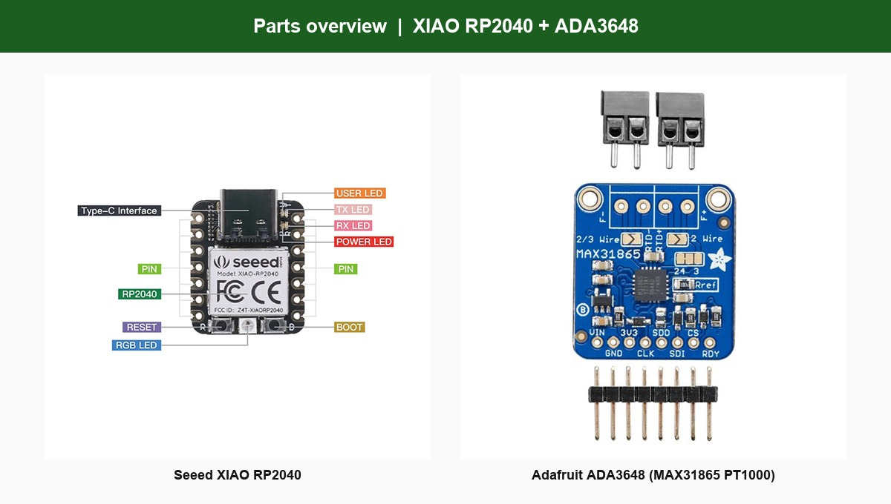

# 00 - Overview

## What this builds

A USB OAT sensor for XCSoar: PT1000 probe -> ADA3648 -> XIAO RP2040 -> USB -> flight computer.



| Role | Part |
|------|------|
| Brain + USB | Seeed XIAO RP2040 |
| RTD amp | Adafruit ADA3648 (MAX31865, PT1000) |
| Sensor | 2-wire PT1000 probe |

## Protocol

XCSoar has no dedicated "temperature only" driver. This project emits OpenVario OAT:

```text
$POV,T,<temperature_celsius>*CS
```

Example: `$POV,T,15.0*07`

In XCSoar: driver **OpenVario**. InfoBox **Outside air temperature**.

## USB on Android / Stefly

Firmware USB ID is **2E8A:0A01** (vendor HID). Not Pico serial `000A`.

A **USB-C (XIAO) to USB-A** data cable is required for typical tablet USB-A ports.
