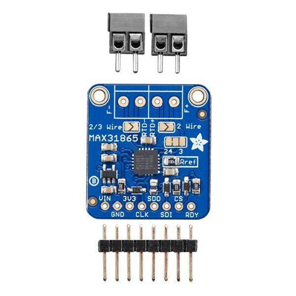

# 02 - Prepare the amplifier (ADA3648)

Kit contents (product photo):

Do this **before** wiring to the XIAO.

## 1. Logic pins — I skipped the header

I did not solder the 8-pin male header. I soldered the PTFE wires straight into the holes: `Vin`, `GND`, `CLK`, `SDO`, `SDI`, `CS`. Leave `3Vo` and `RDY` empty.

A header works too if you prefer Dupont jumpers for a first test.

## 2. RTD terminal blocks

On my board the two 2-pin screw terminals were **already soldered**. If yours are loose in the bag, solder them onto the top RTD holes (`F-` / `RTD-` / `RTD+` / `F+`).

## 3. Configure for 2-wire (critical)

Board defaults to 4-wire. For a 2-wire probe:

1. Solder-bridge **both** triangular **"2 Wire"** pads closed (under the terminal area on the photo above).
2. Alternate: short the two left pads together and the two right pads together with wire.

## 4. Attach the PT1000

1. One probe wire into a **left** terminal, tighten.
2. Other probe wire into a **right** terminal, tighten.
3. Polarity does not matter. Tug-test both.

## Checklist

- [ ] Six logic wires in the holes (or a header)
- [ ] Terminal blocks present
- [ ] Both 2-wire jumpers closed
- [ ] Probe clamped left + right
