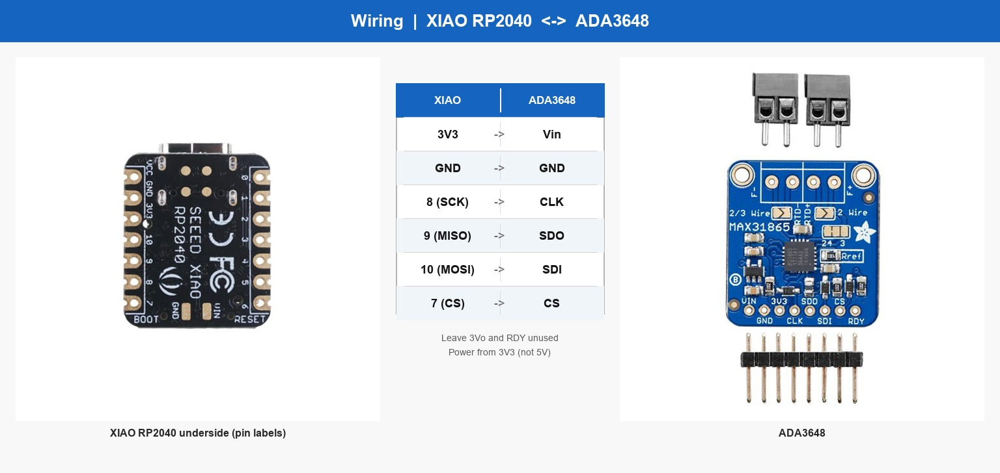
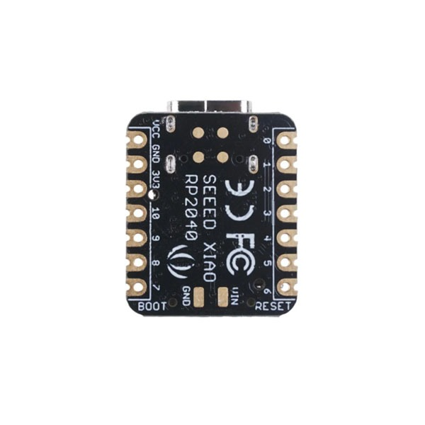

# 03 - Wiring

Power the amp from XIAO **3V3** (not 5V).

## Boards and connections

Left photo is the **XIAO underside** (pin numbers printed on the board).

| XIAO (silkscreen) | ADA3648 |
|-------------------|---------|
| **3V3** | **Vin** |
| **GND** | **GND** |
| **8** (SCK) | **CLK** |
| **9** (MISO) | **SDO** |
| **10** (MOSI) | **SDI** |
| **7** (CS) | **CS** |

Leave ADA3648 `3Vo` and `RDY` unconnected.

Larger XIAO underside for reference:

## Tips

1. Wire GND first, then 3V3, then SPI.
2. Keep SPI wires short for the first test.
3. Most common mistake: swap **SDO/9** with **SDI/10**.
4. Bench-test on a PC before plugging into Stefly.

## Checklist

- [ ] 3V3 -> Vin
- [ ] GND -> GND
- [ ] 8 -> CLK
- [ ] 9 -> SDO
- [ ] 10 -> SDI
- [ ] 7 -> CS
- [ ] Probe already on amp (step 02)
